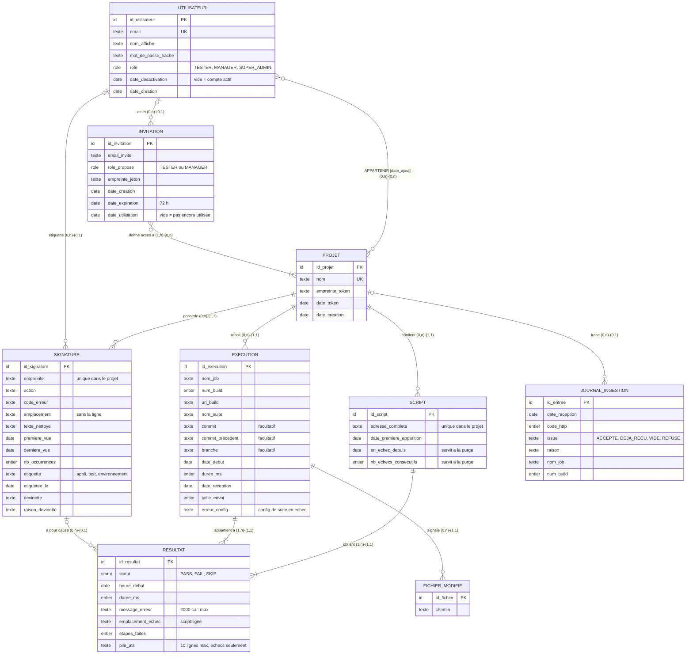

# MCD v3 — Modèle conceptuel des données (Merise)

**Statut** : Validé · **Date** : 11/10/2026

> **Remplace** le MCD v2 (mai 2026), devenu obsolète : `JENKINS_CONFIG` disparaît (aucune connexion à Jenkins), `SCRIPT_NODE` / `SCRIPT_EDGE` sont remplacés par l'adresse complète du script, `RUN_LOG` par les colonnes d'erreur du résultat et la table des signatures, le lien « propriétaire » du projet par l'appartenance.
> **Suite** : [MLD et script SQL](../mld/MLD.md).

## 1. Lire le modèle

- **MCD** = ce qui existe et les liens entre ces choses, sans technique : ni clés étrangères, ni types SQL. Les clés étrangères apparaissent au **MLD**, les types PostgreSQL au **MPD**.
- **Cardinalité (min, max)** : on se place à la place d'**un seul** élément et on compte ses partenaires dans le lien. Le **minimum se regarde sur toute la vie** de l'élément, purges comprises, pas seulement à sa naissance.
- **Diagramme** : Mermaid `erDiagram` (notation « pattes de corbeau »). Les cardinalités Merise exactes sont dans le tableau du § 3 et dans le libellé de chaque lien. `PK` = identifiant, `UK` = unique.

## 2. Diagramme

## 3. Associations et cardinalités

| # | Association | Cardinalités | Justification |
|---|---|---|---|
| 1 | PROJET — *contient* — SCRIPT | (0,n) / (1,1) | Un projet qui vient d'être créé n'a encore reçu aucun envoi, donc aucun script. Un script appartient à un seul projet. |
| 2 | PROJET — *reçoit* — EXÉCUTION | (0,n) / (1,1) | Le token désigne un seul projet : un envoi sans token valide est refusé (401) et rien n'est enregistré. |
| 3 | PROJET — *possède* — SIGNATURE | (0,n) / (1,1) | Les signatures sont propres à un projet (unicité de l'empreinte dans le projet). |
| 4 | PROJET — *trace* — JOURNAL_INGESTION | (0,n) / (0,1) | Un envoi avec un token inconnu est quand même tracé, sans projet ; seul le SUPER_ADMIN voit ces entrées. |
| 5 | SCRIPT — *obtient* — RÉSULTAT | (1,n) / (1,1) | Un script naît de son premier résultat, et la purge le supprime en même temps que son dernier résultat : il n'a jamais 0 résultat. |
| 6 | EXÉCUTION — *appartient à* — RÉSULTAT | (1,n) / (1,1) | Un XML sans aucun test reçoit la réponse « VIDE » et n'est pas enregistré. |
| 7 | SIGNATURE — *a pour cause* — RÉSULTAT | (0,n) / (0,1) | Un résultat vert n'a pas de signature. Une signature **survit à la purge de ses résultats** : elle peut en avoir 0. |
| 8 | EXÉCUTION — *signale* — FICHIER_MODIFIÉ | (0,n) / (1,1) | La liste des `.ats` modifiés est facultative, et une nuit sans modification du dépôt n'en donne aucune. |
| 9 | UTILISATEUR — *étiquette* — SIGNATURE | (0,n) / (0,1) | Une panne n'est étiquetée qu'après coup. Quand le compte de l'auteur est supprimé, l'étiquette reste, sans auteur. |
| 10 | UTILISATEUR — **APPARTENIR** — PROJET | (0,n) / (0,n) | Association **porteuse** (`date_ajout`), sans rôle. Le SUPER_ADMIN voit tout sans être membre ; un projet peut perdre son dernier membre. |
| 11 | UTILISATEUR — *émet* — INVITATION | (0,n) / (0,1) | Un manager n'invite personne. L'émetteur peut être supprimé avant la purge de l'invitation. |
| 12 | INVITATION — *donne accès à* — PROJET | (1,n) / (0,n) | Une invitation sert toujours à rejoindre au moins un projet existant. |

**Pourquoi RÉSULTAT est une entité et APPARTENIR une association ?** Les deux relient deux entités et portent des données. Mais RÉSULTAT est lui-même relié à SIGNATURE, et une association ne peut pas être reliée à une autre association : il devient donc une entité. Rien ne s'accroche à APPARTENIR, qui reste une association.

## 4. Règles d'unicité et d'intégrité

| Règle | Pourquoi |
|---|---|
| Nom du projet unique | Le sélecteur de projet et le SUPER_ADMIN, qui voit tout, ne peuvent pas confondre deux projets |
| Adresse du script unique **dans le projet** | Un même fichier lancé par deux suites = un seul script, un seul historique |
| Exécution unique sur **projet + job + n° de build + suite + date de début** | Un renvoi du même build (même date de début) est reconnu comme doublon. Un job recréé, dont la numérotation repart à 1, a une autre date de début : il est accepté |
| Un seul résultat par script et par exécution | Script présent deux fois dans le XML : fusion, pire statut gardé |
| Empreinte de signature unique dans le projet | Même cause = même signature |
| Email de l'utilisateur unique | Identifiant de connexion |
| Rôle proposé par une invitation : TESTER ou MANAGER seulement | Le rôle SUPER_ADMIN n'est jamais donné depuis l'appli ; imposé par la base au MLD |

## 5. Ce qui est stocké, recalculé ou jamais gardé

| Donnée | Choix | Pourquoi |
|---|---|---|
| Nom du script, dossier du script | Recalculés depuis l'adresse | Une information = un seul endroit (3e forme normale) |
| Modules de l'arbre et compteurs par dossier | Recalculés par le `TreeBuilder` | Pas de table des modules : pas de mise à jour en cascade, pas de module orphelin |
| Compteurs d'une exécution (réussis, échecs, ignorés) | Recalculés en SQL quand un écran les demande | Exécution et résultats sont purgés ensemble : on peut toujours recompter |
| Dernier build où le script est apparu (« absent du dernier build ») | Recalculé depuis les résultats | Un script n'existe que tant qu'il a des résultats |
| Score de confiance, instabilité | Recalculés à la lecture | Toujours justes, jamais périmés |
| `en_echec_depuis`, `nb_echecs_consecutifs`, `date_premiere_apparition` | **Stockés** | Dénormalisation volontaire : ils doivent survivre à la purge des résultats |
| Signatures, avec dates et `nb_occurrences` | **Stockées** | Mémoire longue des causes de casse |
| Token du projet, jeton d'invitation, mot de passe | Empreinte seulement | Une fuite de la base ne donne ni les tokens, ni les liens, ni les mots de passe |
| Lien fichier modifié → script | Pas de lien : chemin seul, comparé aux adresses à la lecture | Découplé ; la plupart des fichiers modifiés sont des sous-scripts, qui ne sont pas des scripts de l'arbre |
| Dernière vue utilisée (arbre ou vue Pannes) | Navigateur (`localStorage`) | Confort d'affichage, pas une donnée métier |
| Token dans le journal d'ingestion | **Jamais** | Pas de secret dans un journal (OWASP 2025, A09) |
| Stack trace complète, paramètres des sous-scripts, chemins de l'agent Jenkins, auteurs de commits | **Jamais** | Minimisation RGPD et sobriété |

## 6. Conservation

| Entité | Durée | Après |
|---|---|---|
| EXÉCUTION, RÉSULTAT, FICHIER_MODIFIÉ, JOURNAL_INGESTION | 60 jours | Purge chaque nuit |
| SCRIPT | Tant qu'il a des résultats | Supprimé avec son dernier résultat |
| PROJET, SIGNATURE | Durables | Un projet sans membre est signalé au SUPER_ADMIN (badge « sans membre »), jamais supprimé automatiquement |
| UTILISATEUR désactivé | 60 jours après la désactivation | Supprimé ; ses étiquettes restent, sans auteur |
| INVITATION utilisée ou expirée | 60 jours après | Supprimée ; d'ici là, un lien expiré répond 410 et le SUPER_ADMIN voit qui a invité qui |

Une seule durée (60 jours) pour toutes les purges : une seule règle à coder, à tester et à expliquer.

## 7. Choix faits pendant la construction du modèle

| Choix | Justification |
|---|---|
| L'arbre suit les **dossiers du dépôt** ; la suite n'est plus une entité ni un niveau de l'arbre, mais une information de l'exécution (`nom_suite`) | Une suite TestNG est la liste des tests que Jenkins lance, pas un rangement des scripts. Évite un niveau inutile (une seule suite par job dans les résultats réels analysés) et les doublons d'un script lancé par deux suites. Remplace l'ancien niveau « suite » de l'arbre |
| Nom de projet unique | Sélecteur de projet sans ambiguïté |
| Pas de lien « propriétaire » du projet, pas d'entité TOKEN, plus de `JENKINS_CONFIG` | Le créateur est un membre comme les autres ; un seul token actif par projet ; aucune connexion à Jenkins |
| Adresse complète seule sur le script | Une information = un seul endroit |
| Compteurs de l'exécution et dernier build vu non stockés | Recalculables tant que les résultats existent |
| Fichier modifié sans lien vers le script | Découplage, voir § 5 |
| Journal d'ingestion gardé 60 jours, rattaché à 0 ou 1 projet | Même règle de purge ; les envois refusés pour token inconnu sont aussi tracés |
| `nom_affiche` (un seul champ, saisi à l'acceptation de l'invitation) | Une liste de membres lisible ; on reste minimal (ni téléphone, ni champs séparés) |
| Comptes désactivés supprimés au bout de 60 jours, étiquettes conservées sans auteur ; `date_desactivation` au lieu d'un booléen | Limitation de conservation (RGPD) ; la date dit à la fois « désactivé » et « depuis quand » |
| Projet sans membre : badge pour le SUPER_ADMIN, pas de purge automatique | Supprimer un projet est irréversible (token, historique, signatures) |
| Invitation valable 72 h, purgée 60 jours après usage ou expiration | Message 410 compréhensible en cas de clic tardif ; trace de qui a invité qui |
| Dernière vue utilisée dans le navigateur | Voir § 5 |
| Date de début dans la clé d'unicité de l'exécution | Sans elle, la base refuserait un job recréé, qui doit pourtant être accepté |

## 8. Évolutions prévues hors V1

| Évolution | Version | Ce qu'elle ajoute au modèle |
|---|---|---|
| Graphe des sous-scripts | V1.5 | Entité DÉPENDANCE (appelant, appelé, dernière vue), agrégée par projet |
| Itération du jeu de données en échec | V1.5 | Propriété `iteration_en_echec` sur RÉSULTAT |
| Version de l'application testée | V1.5 | Propriété `version_appli` sur EXÉCUTION |
| Note sur un script (DIA-06) | Could | Entité NOTE (script, auteur, texte, date) |
| Mot de passe oublié (CPT-09) | Could | Entité proche d'INVITATION (jeton haché, expiration, usage unique) |
| Tendances au-delà de 60 jours (PIL-04) | Could | Entité de résumés mensuels par projet |
| Environnement comme dimension du projet | à revoir après la phase pilote | Entité ENVIRONNEMENT ou propriété de l'exécution |
| Rôle par projet | si le besoin change | Propriété `role` sur APPARTENIR |

## 9. Vers le MLD

- Associations 1 ↔ n : la clé étrangère va du côté « n » (exemple : `script.project_id`).
- Associations n ↔ n : une table chacune, avec une clé primaire composée → `user_project (user_id, project_id, date_ajout)` et `invitation_project (invitation_id, project_id)`.
- Liens (0,1) : clé étrangère facultative (`run_result.signature_id`, `ingest_log.project_id`, `error_signature.label_by`, `invitation.invited_by`), mise à vide quand le partenaire est supprimé.
- Pas de table de session : authentification par JWT sans état.
