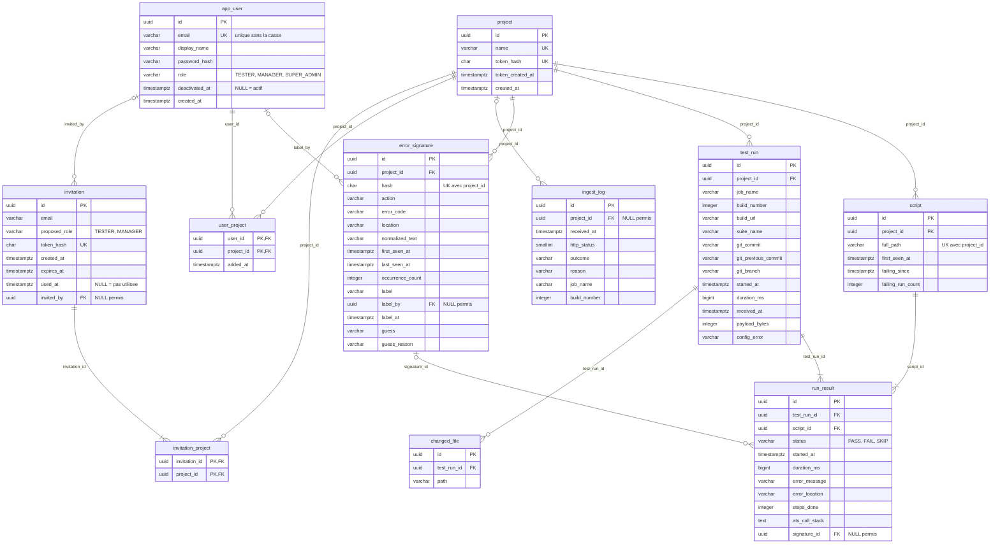

# MLD v1 — Modèle logique des données (relationnel)

**Statut** : Validé · **Date** : 02/11/2026

> **Source** : [MCD v3](../mcd/MCD.md), qui fait foi pour le sens des données.
> **Script de création** : première migration Flyway, [`V1__schema_initial.sql`](../../../back/src/main/resources/db/migration/V1__schema_initial.sql), testé le 02/11/2026 (voir § 6).

## 1. Du MCD au MLD : les règles appliquées

| Règle de passage | Application |
|---|---|
| Une entité → une table, l'identifiant → la clé primaire | 9 entités → 9 tables |
| Association 1 ↔ n → clé étrangère du côté « n » | `script.project_id`, `run_result.test_run_id`, `run_result.script_id`… |
| Association n ↔ n → une table, clé primaire composée des deux clés étrangères | APPARTENIR → `user_project` (+ `added_at`, donnée portée) ; DONNER ACCÈS À → `invitation_project` |
| Cardinalité minimale 0 côté « 1 » → clé étrangère facultative (`NULL` permis) | `run_result.signature_id`, `ingest_log.project_id`, `error_signature.label_by`, `invitation.invited_by` |
| Cardinalité minimale 1 → `NOT NULL` | toutes les autres clés étrangères |

→ **11 tables** : 9 entités + 2 associations n ↔ n.

## 2. Schéma

## 3. Correspondance MCD → tables

| MCD | Table | Remarque |
|---|---|---|
| PROJET | `project` | |
| SCRIPT | `script` | `adresse_complete` → `full_path` |
| EXÉCUTION | `test_run` | Un build Jenkins reçu |
| RÉSULTAT | `run_result` | La brique atomique |
| SIGNATURE | `error_signature` | |
| FICHIER_MODIFIÉ | `changed_file` | Identifiant technique ajouté (`id`) |
| JOURNAL_INGESTION | `ingest_log` | |
| UTILISATEUR | `app_user` | `user` est un mot réservé de PostgreSQL |
| INVITATION | `invitation` | |
| APPARTENIR | `user_project` | Association porteuse (`added_at`) |
| DONNER ACCÈS À | `invitation_project` | |

## 4. Conventions de nommage

- Tables et colonnes en **anglais**, `snake_case`, au **singulier** (`script`, pas `scripts`) : le code Java et l'API sont en anglais, une seule langue du SQL au JSON.
- Clé primaire `id` ; clé étrangère `<table>_id`, sauf quand le nom dit le rôle (`invited_by`, `label_by`).
- Dates en `timestamptz`, suffixe `_at` ; durées en millisecondes, suffixe `_ms`.
- Contraintes **nommées** avec un préfixe : `pk_`, `fk_`, `uk_`, `ck_`, `ix_`. Une erreur affiche alors `uk_test_run_build` au lieu d'un nom généré illisible.

## 5. Choix faits

| # | Choix | Alternative écartée | Pourquoi |
|---|---|---|---|
| M1 | Clés primaires en **UUID v7** (`uuid DEFAULT uuidv7()`, PostgreSQL 18) | `bigint` auto-incrémenté | Défense en profondeur contre l'IDOR : la vraie protection reste le **contrôle d'appartenance au projet à chaque lecture** (réponse 404) ; l'UUID empêche en plus de deviner les identifiants si un contrôle manquait un jour. La version 7 commence par l'horodatage : les identifiants restent rangés dans l'ordre d'insertion, ce qui garde des index compacts. Coût accepté : 16 octets au lieu de 8 |
| M2 | Listes de valeurs en `varchar` + `CHECK` | type `ENUM` de PostgreSQL | Ajouter une valeur = modifier une contrainte, simple dans une migration ; correspondance directe avec `@Enumerated(STRING)` de JPA |
| M3 | Email unique **sans tenir compte de la casse** (index sur `lower(email)`) | `UNIQUE` simple | Sinon `Jean@x.fr` et `jean@x.fr` feraient deux comptes |
| M4 | `run_result → script` en `ON DELETE RESTRICT` | `CASCADE` | Garde-fou : la base **refuse** de supprimer un script qui a encore des résultats (cardinalité 1,n du MCD). `RESTRICT` ne supprime jamais rien : la purge efface d'abord les vieux builds (leurs résultats partent en cascade), puis les scripts restés sans résultat |
| M5 | Suppression d'un projet = suppression en cascade de tout son contenu ; liens facultatifs mis à `NULL` | Tout en `RESTRICT` | Un projet n'est jamais supprimé automatiquement (MCD § 6) ; quand l'admin le supprime, rien d'orphelin ne doit rester |
| M6 | Index sur les clés étrangères utilisées dans les écrans et sur les dates de purge | Pas d'index en plus | PostgreSQL n'indexe pas les clés étrangères tout seul ; la purge de nuit filtre sur `received_at` |
| M7 | Outil de migration : **Flyway** (scripts SQL versionnés `V1__…sql`) | Liquibase (changelogs XML/YAML, retour arrière) | Le SQL reste lisible et identique à ce script ; intégré à Spring Boot ; un seul SGBD visé, donc l'abstraction de Liquibase n'apporte rien |

## 6. Ce que la base garantit, et ce qu'elle ne garantit pas

**Vérifié le 02/11/2026** : le script crée les 11 tables sur **PostgreSQL 18** (image Docker `postgres:18`) ; sur une base de vérification, 7 insertions piégées sont refusées comme prévu. Une partie de ces essais est automatisée dans les tests d'intégration du back (Testcontainers).

| Essai | Résultat |
|---|---|
| Deux comptes `Jean@x.fr` / `jean@x.fr` | Refusé (`uk_app_user_email`) |
| Même build envoyé deux fois | Refusé (`uk_test_run_build`) |
| `build_url` = `javascript:alert(1)` | Refusé (`ck_test_run_build_url`) |
| Résultat `PASS` avec une cause d'échec | Refusé (`ck_run_result_pass_no_signature`) |
| Supprimer un script qui a des résultats | Refusé (`fk_run_result_script`) |
| Invitation avec le rôle `SUPER_ADMIN` | Refusé (`ck_invitation_role`) |
| Purge d'un build, puis des scripts sans résultat | Résultats supprimés en cascade, script supprimé, **signature conservée** |

**Règles laissées au code** (non exprimables simplement en SQL), à couvrir par des tests :
- Une invitation donne accès à **au moins un** projet (cardinalité 1,n).
- Un script naît de son premier résultat : création du script et du résultat dans la **même transaction**.
- Expiration de l'invitation à 72 h (la base vérifie seulement `expires_at > created_at`).
- Purge à 60 jours, dans l'ordre : builds → scripts sans résultat → journal, comptes et invitations.

## 7. Évolutions prévues

Le MCD v3 (§ 8) prévoit déjà `test_run.app_version` (version de l'appli testée) et un éventuel environnement : ce sera une migration Flyway de plus, décidée quand le format multi-environnement sera choisi.
