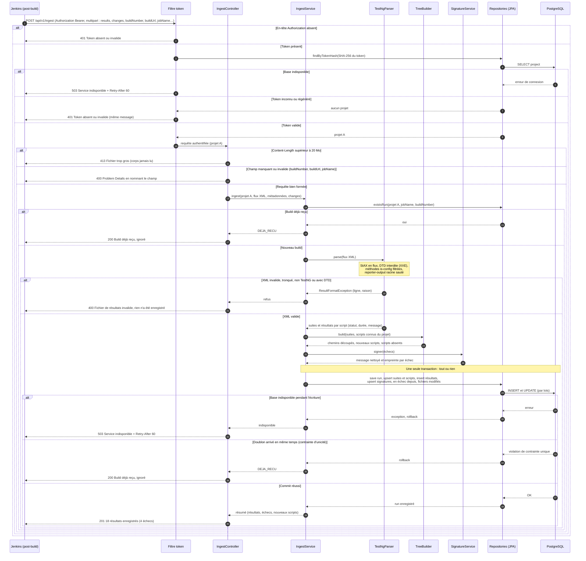

# Diagramme de séquence n° 1 — Ingestion des résultats

> **Statut** : Proposé, sauf les choix Q1, Q4, Q8 et Q14, validés le 09/10/2026. Rédigé le 08/10/2026, mis à jour le 10/10/2026.
> Noms de classes proposés, à confirmer au moment du développement.

---

## Diagramme

Lecture en une phrase : **on refuse au plus tôt et au moins cher** (en-tête, puis taille, puis champs, puis doublon), et on ne lit le XML qu'une fois tout le reste vérifié ; l'écriture est **tout ou rien**.

> Journal d'ingestion (ING-05, Should) : chaque réponse, acceptée ou refusée, sera aussi écrite dans `ingest_log`, dans une transaction séparée (sinon un refus annulerait sa propre trace). Non dessiné pour garder le diagramme lisible.

---

## Les cas d'échec et leurs critères

| Cas | Où il est détecté | Réponse | Rien d'enregistré ? | Critère |
|---|---|---|---|---|
| Token absent | Filtre, sans base | 401 | oui | ING-02.2 |
| Token inconnu ou régénéré | Filtre, après recherche du hash | 401, même message | oui | ING-02.3 |
| Payload trop gros | Contrôleur, sur l'en-tête `Content-Length` (configuration multipart de Spring) | 413 | oui, corps jamais lu | ING-01.4 |
| Champ manquant | Contrôleur (Bean Validation) | 400 | oui | ING-01.1 |
| XML invalide, tronqué, non TestNG, avec DTD | Parseur | 400 | oui | ING-01.3, ING-01.5 |
| Doublon de build | Service, avant parsing ; puis contrainte d'unicité en base | 200 « déjà reçu » | oui | ING-01.6 |
| Base indisponible | Filtre ou repositories | 503 + `Retry-After` | oui (rollback) | — |

---

## Questions de conception

| # | Question | Options | Choix (validé ou proposé) | Justification |
|---|---|---|---|---|
| Q1 | Format du corps de la requête | XML brut + paramètres d'URL · JSON avec XML en base64 · **multipart** | **Validé** — **Multipart** : XML et liste des `.ats` en fichiers, métadonnées en champs texte | Standard des envois de fichiers ; natif dans `curl -F` et Spring ; pas de métadonnées dans l'URL (logs des proxys) ; pas de +33 % du base64 |
| Q2 | Ordre des contrôles | Lire le XML d'abord · **du moins cher au plus cher** | Proposé — Token → taille → champs → doublon → XML → écriture | Un envoi anonyme de 1 Go reçoit un 401 sans que le corps soit lu (sécurité, éco-conception) ; on ne parse jamais un build déjà reçu |
| Q3 | Synchrone ou asynchrone | **Synchrone** (réponse après enregistrement) · asynchrone (`202 Accepted` + file d'attente) | Proposé — **Synchrone** en V1 | Le testeur doit lire le résultat dans la console Jenkins (ING-01.3) ; 227 Ko se parsent en quelques millisecondes ; une file d'attente ajouterait un composant sans besoin. À revoir si les fichiers dépassent plusieurs Mo |
| Q4 | Clé de dédoublonnage | projet + suite + n° de build (ancien critère ING-01.6) · **projet + job + n° de build** (+ suite pour l'unicité en base) | **Validé** — **projet + job + n° de build** — **ING-01.6 à modifier** en conséquence. Même clé avec une date de début de suite différente → job recréé : accepté et noté dans le journal | Dans Jenkins, un n° de build n'est unique **que dans son job** : deux jobs qui lancent la même suite peuvent avoir le même n° → faux doublon avec l'ancienne clé, résultats perdus sans erreur. Bonus : la vérification se fait **avant** de lire le XML |
| Q5 | Réponse à un doublon | 409 Conflict · **200 OK « déjà reçu »** | Proposé — **200** | Renvoyer un build n'est pas une erreur (envoi idempotent) ; un 409 ferait afficher un échec dans Jenkins pour rien |
| Q6 | Parseur XML | DOM · SAX · **StAX** · liaison automatique (JAXB, Jackson XML) | Proposé — **StAX** (`XMLStreamReader`), durci | Lecture en flux : mémoire constante, on saute le `reporter-output` (57 % du fichier) ; plus lisible que SAX ; la liaison automatique chargerait tout et se configure mal contre XXE |
| Q7 | Protection XXE | Filtrer le texte · **désactiver les DTD dans le parseur** | Proposé — `SUPPORT_DTD = false`, `IS_SUPPORTING_EXTERNAL_ENTITIES = false`, `FEATURE_SECURE_PROCESSING` | Recommandation OWASP (aide-mémoire XXE) ; un `testng-results.xml` n'a jamais de DTD |
| Q8 | Taille maximale | 1 Mo (défaut Spring) · 10 Mo · **20 Mo** · illimitée | **Validé** — **20 Mo**, en configuration | ≈ 1 500 scripts au poids observé (12,6 Ko par script), ×3 de marge ; le défaut Spring de 1 Mo refuserait déjà une campagne de 80 scripts |
| Q9 | Atomicité | Script par script · **tout ou rien** | Proposé — Une transaction pour tout l'envoi | « Rien n'est enregistré » (ING-01.3) ; jamais un build à moitié affiché dans l'arbre |
| Q10 | Base indisponible | 500 · **503 + `Retry-After`** | Proposé — 503 | `curl --retry` réessaie tout seul sur 503 ; 500 voudrait dire « bug de Testree » |
| Q11 | Format des erreurs | Texte libre · JSON maison · **Problem Details (RFC 9457)** | Proposé — Problem Details (`ProblemDetail` de Spring) | Standard, natif dans Spring, lisible dans la console grâce à `--fail-with-body` |
| Q12 | Un refus de Testree fait-il échouer le build Jenkins ? | Oui · **non** | Proposé — **Non** (repli `echo` en cas d'échec du `curl`, dans le snippet) | Testree observe la campagne, il ne doit jamais la casser (même logique qu'ING-04.3) |
| Q13 | Où calculer les signatures d'erreur | À l'affichage · **à l'ingestion** | Proposé — À l'ingestion, dans la même transaction | la table des signatures doit exister avant la purge des résultats |
| Q14 | Rôle du `TreeBuilder` à l'ingestion | Créer des nœuds « module » en base · **découper les chemins, repérer les nouveaux scripts et les absents** | **Validé** — Pas de table des modules ; l'arbre est recalculé depuis `script.full_path` à l'affichage | Un renommage de dossier ne demande aucune mise à jour en cascade (ING-03.4) ; pas de modules orphelins après la purge (PIL-01.2) |
| Q15 | Compression (`gzip`) | Oui · **non en V1** | Proposé — Non | 6 Mo pour 500 scripts reste raisonnable ; décompresser côté serveur ouvre le risque de « bombe zip » à borner aussi |

---

## Ce qu'il faudra tester (base du plan de tests)

- **Unitaires** (sans Spring) : `TestNgParser` (formats valides, tronqués, DTD), `TreeBuilder` (cas de test du découpage des chemins), `SignatureService` (tests paramétrés sur le nettoyage).
- **Intégration** (`@SpringBootTest` + Postgres en conteneur) : 201, doublon, rollback après une erreur au milieu de l'écriture.
- **Sécurité** : 401 sans token, token régénéré, token du projet A qui ne peut écrire que dans A (ING-02.4), XXE (ING-01.5), 413.

---

